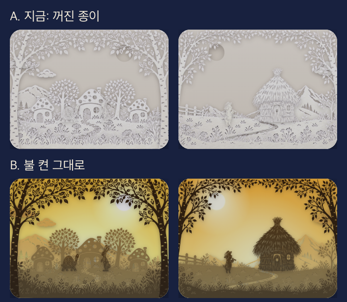

# 앱 디자인 계획 (제안, 2026-11-02)

> 배포한 웹을 데스크톱·휴대폰·아이패드 크기(헤드리스 크롬)로 돌려 보고 쓴 계획이다. §7 외에는 사용자 확인 전이다. 확정되면 `PLAN.md` §4·§5-5 에 옮긴다. `CLAUDE.md` 의 결정(놀이 모드 없음, 빛 상자, 그림은 이미지 생성)은 그대로 둔다.

## 1. 디자인 방향

**"어두운 방에서 작은 극장을 켜는 앱."** 쓰는 사람은 깜깜한 방에서 아이 옆에 누운 보호자다. 그래서 세 가지를 기준으로 판단한다.

1. **방을 밝히지 않는다.** 화면에서 가장 밝은 것이 눈을 찌르면 실패다.
2. **앱이 아니라 무대.** 설명 글과 카드는 줄이고 빛 상자가 화면의 주인이 된다.
3. **한 손, 두 번 톡이면 시작.** 고르기 → 불 켜기. 그 뒤로는 손댈 일이 없다.

이 앱만의 순간은 **불이 켜지는 전환**이다. 흰 종이가 붉은 그림자극으로 바뀌는 그 순간에 디자인 힘을 모은다.

## 2. 지금 화면에서 본 문제

| 화면 | 문제 | 왜 문제인가 |
|---|---|---|
| 홈 | 타일이 뿌옇고 서로 비슷하다 | 흰 종이는 대비가 낮아, 작게 줄이면 레이스 무늬만 보인다. 앱의 강점인 빛이 없다 |
| 홈 | 흰 인형이 흰 배경에 묻힌다 | 토끼 타일에서 토끼·거북이가 안 보인다 |
| 홈 | 타일이 가장 밝다 | 어두운 방에서 시선과 눈부심이 타일에 몰린다 |
| 홈 | 첫 화면 절반이 설명 카드 | 정작 동화는 휴대폰에서 스크롤해야 보인다(두 모드 카드가 첫 화면을 차지한다) |
| 홈 | 주황 단추가 크게 튄다 | 잠자리 화면에서 가장 강한 색이 '아무 이야기나'에 쓰였다 |
| 홈(휴대폰) | 타일이 한 줄에 하나, 전체 2289px | 5편만으로 네 화면 넘게 내려가야 한다 |
| 표지 | 불 켜기 전에도 멈춤·건너뛰기가 보인다 | 아직 시작하지 않았는데 조작부터 보인다 |
| 재생(휴대폰) | 세로 화면에 상자가 작고 위아래가 빈다 | 무대감이 약하다. 자막도 기본 꺼짐이라 빈 곳만 남는다 |
| 스플래시 | 그림 없이 노을 그라데이션 + 흐린 글자 | 커튼 그림이 없어서 생긴 임시 상태. 첫인상으로 쓸 수 없다 |
| 그림 없는 3편 | 재생해도 빛만 나온다 | 시범판에서 '아무 이야기나'가 이 3편을 고를 수 있다 |

## 3. 썸네일

### 먼저 시험해 본 것


휴대폰 2열 크기로 같은 장면을 꺼짐·켜짐으로 찍어 비교했다. (비교 그림 아래쪽 줄은 넣지 않았다. 확대 시험은 화면이 거의 달라지지 않아 판단 근거로 쓰지 않는다.)

| | 평균 밝기 | 인물이 보이나 | 무슨 이야기인지 |
|---|---|---|---|
| 꺼진 종이(지금) | 0.73 | 거의 안 보임 | 알기 어렵다 |
| 불 켠 그대로 | 0.47~0.50 | 보임, 다만 작다 | 나아졌지만 무대 사진 같다 |

여기서 세 가지를 알았다.
- **불을 켜는 편이 낫다.** 평균 밝기가 약 3분의 1 줄고 인물도 살아난다.
- **장면을 그대로 줄이면 부족하다.** 인물이 작고 프레임 나무가 자리를 차지한다.
- **빛 색이 겹친다.** 두 타일 모두 노란빛이라 나란히 놓으면 구별이 안 된다.

### 제안: 동화마다 전용 표지 한 장
장면을 잘라 쓰지 않고 **썸네일용 구도를 따로 만든다.** 규칙은 다섯 가지다.

1. **주인공 실루엣 하나가 타일 높이의 절반 이상.** 프레임 나무는 뺀다.
2. **그 동화를 한 장면으로 말해 주는 순간.** 설명 없이 알아봐야 한다.
3. **동화마다 빛 색을 정한다.** 책장에 꽂힌 책등처럼 색으로 기억하게 한다.
4. **글자를 넣지 않는다.** 제목은 그림 아래에 앱 글자로 쓴다(작은 크기에서도 읽히도록).
5. **평소엔 낮은 빛.** 홈에서는 빛을 줄여 두고, 고르면 끝까지 밝아진다.

| 동화 | 그림 한 장면 | 빛 색 |
|---|---|---|
| 토끼와 거북이 | 나무 밑에 잠든 토끼 곁을 지나는 거북이 | 달밤 남보라 |
| 아기 돼지 삼형제 | 벽돌 집 창문에 비친 불빛, 앞에 선 세 돼지 | 벽난로 호박색 |
| 해와 바람 | 큰 해 아래 외투를 여미는 나그네 | 한낮 금빛 |
| 미운 아기 오리 | 물 위의 백조와 그 그림자 | 새벽 청록 |
| 커다란 순무 | 커다란 순무를 줄지어 당기는 식구들 | 저녁 붉은 주황 |

**만드는 법:** 동화마다 흰 종이 그림 1장(`art/<id>/cover.webp`)을 이미지 생성으로 만들고, 빛은 지금처럼 앱이 입힌다. 5장이면 되고, 표지·잠금 화면 그림도 여기서 나온다. 그림 규칙(흰 종이만, 코드로 그리지 않음)은 그대로다.

**`PLAN.md` 와 다른 점:** §4·§5-5 는 "타일은 꺼진 흰 종이, 대표 상자를 그대로 축소"인데, 이 제안은 바꾼다. **"켜지는 순간"의 놀라움이 줄 수 있다**는 대가가 있어, 타일은 낮은 빛으로만 켜 두고 눌렀을 때 밝아지게 한다.

## 4. 화면별 계획

### 홈: 극장 로비에서 책장으로
```
┌───────────────────────┐
│ 쿨쿨 그림자극장    (달)│  작은 글자 머리줄
│ ┌───────────────────┐ │
│ │  오늘 밤 이야기     │ │  큰 상자 하나(어제 안 들은 편)
│ │  [큰 표지, 낮은 빛] │ │
│ │  토끼와 거북이 · 5분 │ │
│ │  [▶ 읽어 줘요][함께]│ │
│ └───────────────────┘ │
│ ┌────────┐ ┌────────┐ │  휴대폰도 2열
│ │        │ │        │ │
│ └────────┘ └────────┘ │
│ 듣고 끄기 (1)(2)(3)(5) │
└───────────────────────┘
```
- 모드 카드 두 개를 없앤다. **고르는 건 이야기**이고, 어떻게 볼지는 그다음이다. 모드 설명은 첫 실행에 한 번만 보여 준다.
- 맨 위 큰 상자는 '오늘 밤 추천' 한 편. 고민 없이 두 번 톡이면 시작된다. '아무 이야기나'를 대신한다.
- 이어 읽기가 있으면 그 자리에 대신 보인다.
- 아이패드는 왼쪽에 큰 상자, 오른쪽에 타일.

### 고르기 → 불 켜기: 하나로 합친다
지금은 타일 → 시트(이미 불이 켜짐) → 플레이어(다시 꺼짐) → "톡 눌러서 불을 켜요" 순서라 **불이 두 번 켜지고 단계가 하나 많다.** 그래서 합친다.
- 타일을 톡 → 그 상자가 커지며 화면을 채운다(시트 없음).
- 아래에 **[▶ 읽어 줘요] [함께 읽어요]**. 누르면 그 자리에서 불이 켜지며 바로 시작된다.

### 재생
- 시작 전엔 조작부를 숨긴다. 재생 중엔 지금처럼 알아서 사라진다.
- 휴대폰 세로는 상자를 위로 올리고, 빈 아래쪽은 그대로 어둡게 둔다. 아이 곁에 놓는 경우가 많으니 **가로로 돌리면 화면 전체가 무대**가 되게 한다.
- 단추를 밤색 계열로 낮춘다.

### 함께 읽기
화면 구성이 가장 잘 맞는 화면이라 크게 바꾸지 않는다. 지난 줄의 글자가 조금 더 잘 보이게만 조정한다. 주황 → 단추는 유지한다. 여기서는 이 단추가 정말 주인공이다.

### 스플래시·잠드는 화면
- 스플래시: 커튼 그림 4장을 먼저 만든다. 그 전에는 **글자 없이 남색 화면 + 달**만 보여 준다.
- 잠드는 화면: 지금은 달과 "잘 자요" 뒤로 **단추가 환하다.** 마지막 상자의 꺼진 실루엣을 아주 어둡게 깔고, 단추는 화면을 만져야 보이게 한다.

## 5. 기본 규칙(디자인 토큰)

| 항목 | 지금 | 제안 |
|---|---|---|
| 바탕 | 남색 `#18213f` | 더 깊은 밤색. 시험 후 결정 |
| 카드 | 테두리 있는 카드 여러 개 | 카드를 줄이고 빛 상자와 여백으로 구분 |
| 강조색 | 주황 `#e8703a` 크게 | 화면당 하나, 함께 읽기 → 단추 등 꼭 필요한 곳만 |
| 제목 글자 | 굵은 고딕 | 표지·스플래시만 오린 글자 그림(이미지 생성), 나머지는 지금 글꼴 |
| 그림 기호 | 📖 이모지와 SVG 기호가 섞임 | 크림 단색 기호로 통일(`PLAN.md` §5-5) |
| 움직임 | 빠른 전환 | 빛은 느리게(1초 이상), 누름 반응은 바로 |

## 6. 진행 순서

1. **표지 2장 시범:** 토끼와 거북이·아기 돼지 삼형제 `cover`를 만들어 휴대폰 크기로 확인. 이 단계에서 썸네일 방식을 확정한다.
2. **홈·고르기 개편:** 모드 카드 제거, 오늘 밤 상자, 2열, 불 켜기 합치기.
3. **스플래시 그림 4장·잠드는 화면.**
4. **재생 다듬기:** 조작부, 세로·가로 배치.
5. **실기기 밤 시험:** 실제로 어두운 방에서 아이폰·아이패드로 눈부심·단추 크기 확인. 헤드리스 크롬으로는 알 수 없는 부분이다.

## 7. 결정된 것 (2026-11-02)

1. **타일은 항상 켜 둔다**(낮은 빛·누르면 밝아짐 없이). 적용함.
2. **모드 카드 두 개를 없앤다.** 적용함.
3. **불 켜기 단계를 없앤다.** 적용함. 고르기와 시작을 하나로 합치는 개편(§4)은 아직이다.
4. **광원은 뒤판 전체.** 달·해는 오린 구멍처럼 보이게 고침. 시안만큼 빛이 뚫고 나오려면 그림에 구멍이 더 필요하다.

5. **층을 늘려 깊이를 만든다.** 시범 동화 2편의 상자 7벌을 모두 6층으로 바꿨다. 무늬가 많아진 만큼 뒤 층은 옅게(`dk`), 인형은 진하게 해서 인형이 묻히지 않게 한다.

## 8. 화면 개편 (2026-11-02, 적용함)

"흰 벽에 불 켠 창문." (바탕은 처음에 어두운 벽으로 만들었다가 사용자 결정으로 흰색으로 바꿈. 불 끈 방에서 쓰는 앱이 아니므로 §1의 '어두운 방' 기준은 쓰지 않는다.) 톡톡 동화극장 홈의 뼈대(크게 추천 하나 + 시작 단추 + 그림 줄, 단색 기호, 강조색 하나)는 가져오고 아래를 다르게 했다.

| | 톡톡 동화극장 | 쿨쿨 그림자극장 |
|---|---|---|
| 바탕 | 연회색 + 흰 카드 | 흰 종이 `#fbfaf7`, 카드 없음 |
| 그림 틀 | 꽉 찬 배너, 둥근 네모 | 아치 창문. 그림자에 빛 색이 묻어남 |
| 강조색 | 감빛 `#D9622F` | 등잔빛 `#F2B366`(화면당 하나) |
| 고르기 | 카드 한 번 톡 = 바로 시작 | 작은 창문 톡 = 큰 창문이 바뀜, 단추로 시작(읽는 방식이 둘이라서) |
| 길이 | 스크롤 | 휴대폰 세로·아이패드 모두 스크롤 없이 한 화면(휴대폰 가로만 스크롤) |

- 시트를 없앴다. 이어 읽기는 '함께 읽어요' 단추에 합쳤고 '처음부터'를 곁에 둔다.
- 동화마다 표지 빛 색을 정했다(§3의 색 기억). `home.js` `COVER_LIGHT`, 그림은 그대로이고 전용 표지 그림은 아직 없다.
- 재생: 머리줄에 장면 점, 조작부는 6초 뒤 물러나고 톡 하면 돌아온다. 가로에서는 무대가 화면 높이를 다 쓴다.
- 스플래시: 커튼 그림이 오기 전까지 달과 이름만.

**그림 없는 편(§7 미정)은 불 꺼진 빈 창문 + "그림 준비 중"으로 두고 누를 수 없게 했다.** '아무 이야기나'에서도 뺀다. 첫 상자 그림 파일이 생기면 저절로 열린다.
